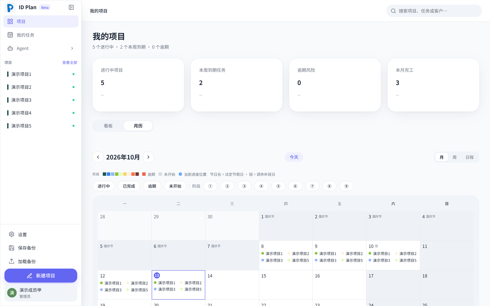
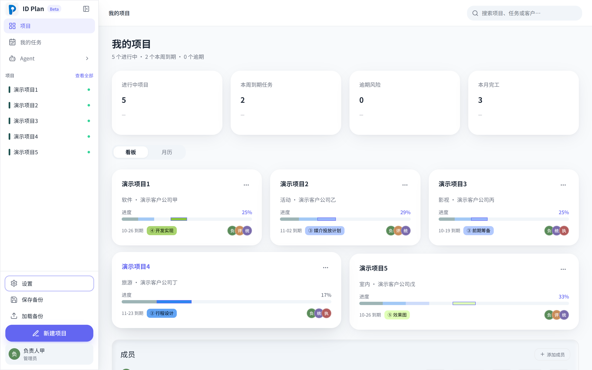
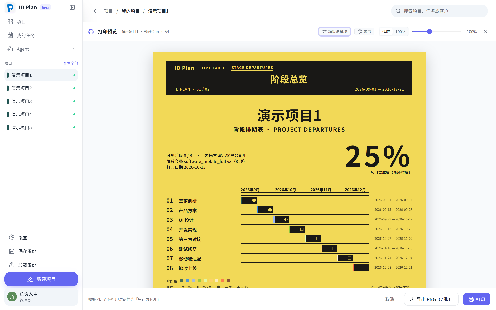
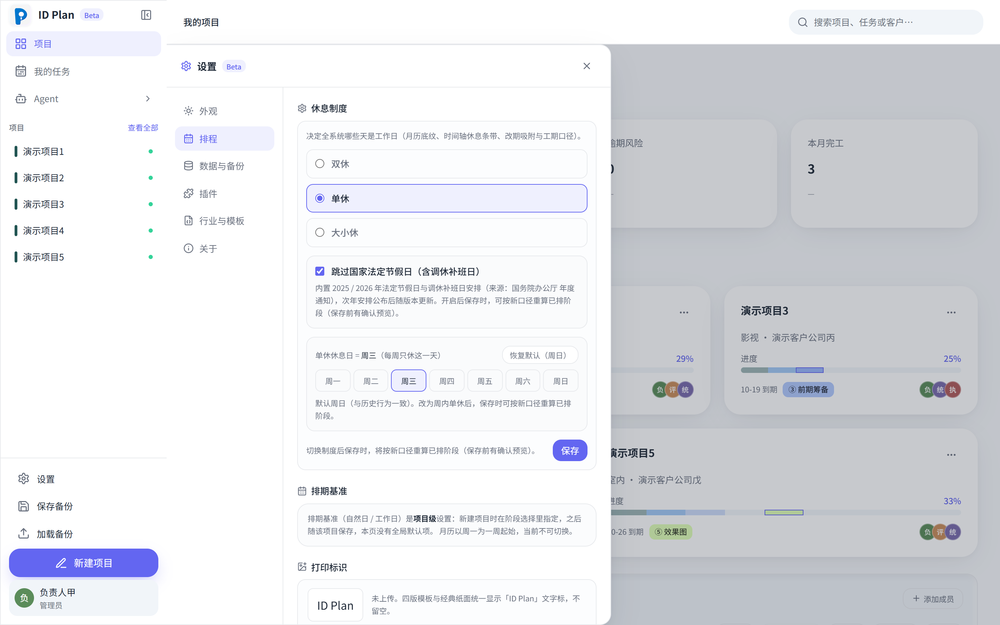
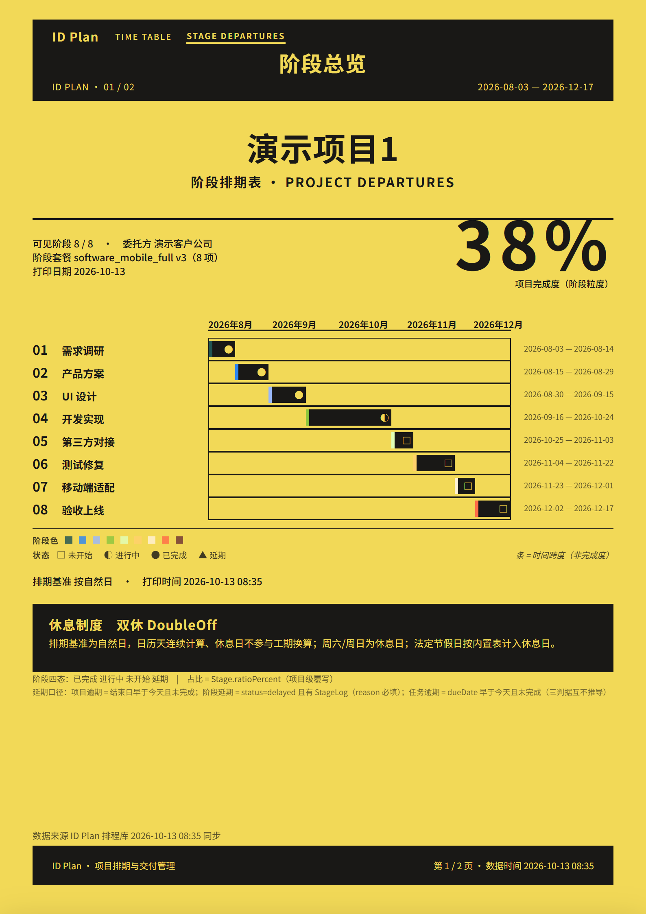
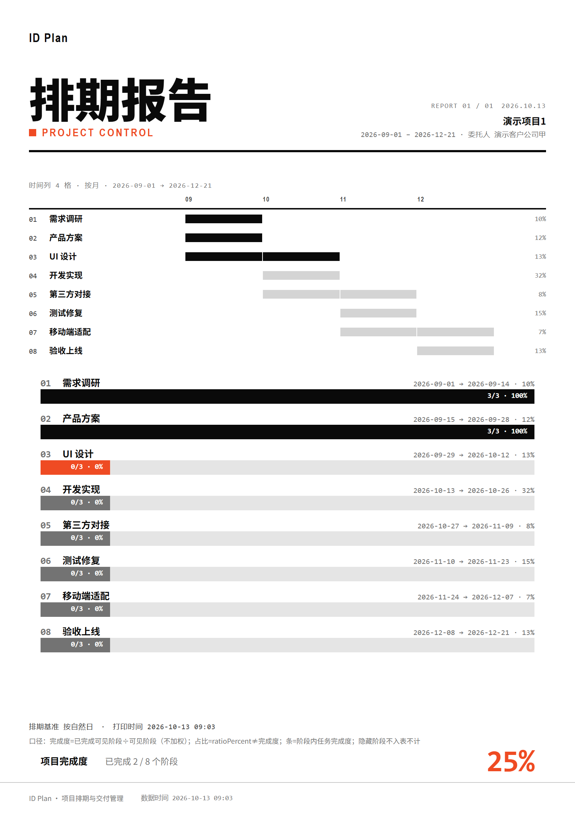
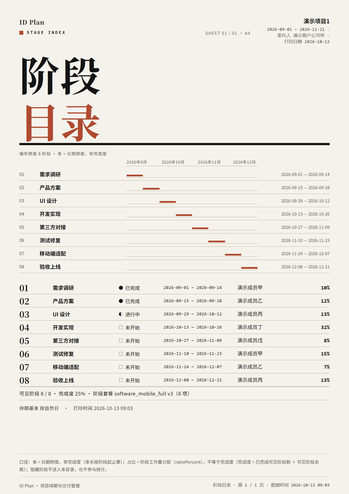
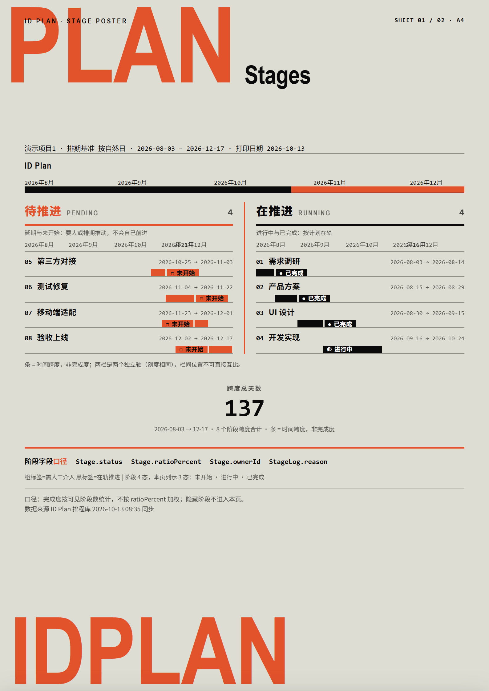

<p align="center">
  
</p>

<h1 align="center">ID Plan</h1>

<p align="center">
  <strong>Break a project into one stage timeline you can actually read — an offline-first project scheduling tool.</strong>
</p>

<p align="center">
  <a href="./LICENSE"></a>
  
  
  
  
</p>

> 🌐 English · [中文](./README.md)

> Covers **7 industry groups / 9 domains / 29 stage presets / 74 stage definitions** (software development, marketing campaigns, film production, wedding planning, consulting delivery, travel, architecture & interiors …). It turns a project's budget, type, stage milestones and members into one timeline — read progress as a board (kanban), a calendar or a gantt, and export the schedule as a delivery page you can send straight to a client.
> **Statutory holidays built in** (2025 / 2026, make-up workdays included): the calendar shows holiday names, a schedule can skip them in one click, and changing the rest policy reflows projects you already built — see [📅 Scheduling & delivery](#-scheduling--delivery).
> **Printing ships four templates, and each carries the same five content blocks** (Print header / Print timeline / Project info / Stage list / Footer), laid out in that template's own typographic language — see [🖨️ Printing](#-printing-four-templates-one-set-of-content-four-readings).
> **It also lets external AI writers (WorkBuddy / Codex and friends) onboard by reading a single file and write tasks straight into your board** — see [🤖 Agent Access](#-agent-access).
> **The plugin system is open**: the interface spec lives in the same repo as the code, so anyone can write a plugin against the spec and install it — see [🧩 Plugins](#-plugins).

---

## 📸 A look

> Every screenshot below uses the **built-in demo data** (`Demo Project 1..5`, no real client information anywhere). To see the same data on your own machine: after installing, use **“Load sample projects” at the bottom of the sidebar** (that entry point comes from the built-in “Sample Projects” plugin — if it isn't in your sidebar, turn it on under **Settings → Plugins**; you can also load it straight from the first-run guide card).

<p align="center">
  
</p>

<p align="center">
  
  
</p>

<p align="center">
  
</p>

<p align="center">
  
  
  
  
</p>

> The same data, shown as the **first page** of all four templates. What the calendar screenshot makes visible: statutory holidays shaded grey with the holiday name, make-up workdays tagged “班”, a “project colour dot + project name” inside each cell, and a dot on today.

---

## 💡 Why this exists

I built this to schedule my own project timelines: several projects running at once, with the order of stages, the durations and who owned what living in my head and in spreadsheets — syncing progress once cost me half a day.

Then I realised that **any work that splits a project into stages is the same job** — so it ships with a stage library for 7 industry groups, and also lets you generate a library for your own industry and import it. Stages, tasks, members and schedule live in one place; progress is managed in the same operation, and you can export it for a client in one click. **Clear stages, visible progress.**

It now ships in three forms: **Windows desktop** (data on your machine), **UGREEN NAS** (team-shared), and **browser / Docker**. All three share the same scheduling engine and stage library.

---

## ✨ Highlights

### 🧭 Setup: pick the industry, then the stages
- **Three-level cascading setup** — industry group → domain → stage preset. Nothing is pre-selected on first open; the presets and stages only appear once you have picked an industry.
- **7 industry groups / 9 domains / 29 stage presets** — software development, marketing campaigns, film production, wedding planning, consulting delivery, travel, architecture & interiors (including interior / landscape) … Every industry has stages and board columns that fit its own workflow; this is not the same nine stages with new names.
- **Board columns follow the industry** — software gets planning / design / development / testing / release, film gets pre-production / shooting / post-production / delivery; they don't share one set of columns.
- **Your own industry, defined by you** — built-in library doesn't fit? In Settings, “copy the prompt → send it to your Agent → import it back” gives you your own industry library in three steps.

### 📅 Scheduling & delivery
- **Statutory holidays built in** — the full 2025 / 2026 arrangement (source: the annual notices of the State Council General Office, **make-up workdays included**; 2027 follows once announced, and a missing year degrades gracefully instead of guessing). Calendar cells show the holiday name; make-up workdays are tagged “班”.
- **A schedule can skip holidays** — one switch in Settings: turn it on and newly created schedules skip statutory holidays automatically; **holiday cells in the calendar hold no entries either** (no self-contradiction where the cell says “rest” and an entry says “work”).
- **Change the rest policy, existing projects reflow automatically** — after switching from two days off to one, old projects don't stay on the old basis: a dialog lists the blast radius (how many projects, how many stages), with **same duration + chained shift** as the default, or switch to “adjust durations” and fill in new day counts stage by stage. Completed stages are frozen whole (their dates are a fact of finished work; history is not rewritten), and every change leaves a trace you can audit.
- **Rest days are yours to decide** — with a single day off you pick which weekday it is (not necessarily a weekend); with two days off you pick any two, whether **consecutive** (Friday + Saturday) or **split** (Saturday + Monday).
- **Multiple views** — board (kanban), calendar, and a gantt timeline you can drag to reschedule.
- **The calendar tells you the project name at a glance** — each entry is “project colour + project name”; when a day can't fit them all you get “+N” to open everything for that day — no more stacked colour bars where you can't tell who is who.
- **Two themes** — light / dark / follow system.

---

## 🖨️ Printing: four templates, one set of content, four readings

In print preview you pick a template, tick the content, tune the colours. **The four templates aren't four recolourings — they're four ways of reading.** The timeline block especially grows the shape it should have in each one:

| Template | Reading mode | What its timeline looks like |
|---|---|---|
| **A · Swiss Schedule** | Transit timetable: read vertically, three staggered columns, numbers first | **Full-width running chart** (read horizontally — the only horizontal block on the page) |
| **D · Data Editorial** | White/black/orange/red hard edges: matrices and numbering | **Date-cell matrix** (columns = time cells, rows = stages, cells = schedule) |
| **E · Editorial Index** | Warm light paper index: giant numbering | **Chronological span index** (a thin span bar set into the right-hand segment of each index row) |
| **H · Agent Poster** | Grey/white/orange poster: skim-reading, two columns | **Two-column segmented-axis gantt** (ruler inside each column + span bars) |

- **Content is only the five blocks** — **Print header** (project name / period) · **Print timeline** (gantt) · **Project info** (scheduling basis) · **Stage list** · **Footer** (signature / page number). All four templates print **exactly these five blocks**, but each arranges them in **its own typographic language** (A is a running chart, D a cell matrix, E an index, H a two-column span band) — **the typography follows the template; it isn't one table wearing four skins**.
- **Per-block toggles, one-to-one with the paper** — ticked means printed, unticked means not: uncheck a block and the paper **loses exactly one visible region**, with no knock-on effects on the others.
- **A template's own identity elements stay out of the toggle list** (black top bar, giant type, sheet tags, summary bands …) — they are this template's identity, and drop one and it is no longer the same template. The picker states the reason.
- **All four gantts share one ruler** — **value-for-value aligned** with the Classic template's timeline: the same data yields an identical time window, band positions and month ticks (a dedicated equivalence assertion pins this down).
- **The Classic template is kept** — the earlier “Print timeline + Stage list” sheet is there unchanged (and is the default template), with all five blocks individually toggleable.
- **Custom colours** — 3 controlled tokens per template (identity colour / body text / line colour), plus preset variant cards you click to apply; custom values pass through a **hard contrast gate**: if any of the three pairs misses its contrast ratio (4.5 / 3 / 1.5), saving is **refused**, naming which pair and what the ratio was — not a warning message, an engineering gate (greyscale legibility is a hard constraint of print).
- **Your own logo** — uploaded in Settings (admin), automatically greyscale-binarized so it stays legible in black-and-white printing, with its own position in each of the four templates, and it **travels with your backup** (so it comes back on another machine).
- **The picker is a modal, not a strip** — a centred master-detail dialog: template list with thumbnails on the left, content checkboxes + colour slots on the right; the estimated page count updates live.
- **Preview zoom** — a slider plus Ctrl+scroll; zoom applies to the preview only, and **never goes into the print output or the PNG export**.
- **Pagination is computed** — every height estimate is calibrated against real output (allowed to overshoot by at most 10%), with “rows never split across a page, headers never left alone”; for projects with a lot of stages the timeline **continues across pages** (with a “cont.” marker, continuous row numbers and the same ruler), so that **nothing on the paper is ever clipped**.

---

## 👥 Collaboration
- **Task assignment** — a task can be assigned to several members; participants can tick off their own completion, and progress syncs live.
- **Role permissions** — admins see the whole picture; regular members only see the projects and tasks that concern them (settings sections are scoped to identity as well).
- **Member boards** — after signing in, each member sees the progress of the projects they are involved in; admins can search a member's name or click a member in the list to jump straight to anyone's overdue / in-progress / recently completed work.
- **Password sign-in** — admins can set / clear a password per member.

### 💾 Data
- **Backup & restore** — one-click JSON export / import with full validation of the format; backups from older versions import safely.
- **Offline-first** — desktop data lives in the local IndexedDB; no network required.

---

## 🧩 Plugins

ID Plan's interface is assembled from a set of **contribution points**: routes, sidebar entries, settings sections. A registry wires them up, and the plugin switch is a **real switch** — turn it off and its routes never enter the route table and its sidebar entry never renders (not greyed out, not hidden).

**There are three ways to install a plugin** (this is what the current version actually does — no promises):

| Path | How to install | Who it's for |
|---|---|---|
| **Shipped with the version** | The plugin is merged into this repo under `src/plugins/`, released with the installer, and enabled under Settings → Plugins | Everyone (the mainstream route today) |
| **Install from file** | Settings → Plugins → Install from file: pick a plugin file; before installing, its manifest and capability list are laid out for you; loaded in a sandbox, read-only to start with | Anyone who wants to try someone else's plugin |
| **Remote marketplace** | ❌ Not in v1 (it needs a signing system; it's sitting on the roadmap) | — |

**The security boundary, stated up front**: a v1 plugin can only **read** project data on the human side (it has no access to repositories and cannot write to the database — this is pinned down by static guards, not a verbal agreement); foreign code runs in a sandboxed iframe and can't reach your page or your local database; but it **can access the network** (stated before you install it; the root fix, a CSP, is on the roadmap).

**Want to write one?** The interface spec lives in the same repo as the code — you can copy your first plugin in 30 minutes:

- 📜 [**Plugin contract**](./docs/plugin-api/contract.md) — manifest fields, the read-only data outlet, the three contribution points, hard prohibitions, style tokens
- 🧪 [**A complete example**](./docs/plugin-api/example.md) — a “meeting-room occupancy board”: manifest + panel + unit tests, ready to copy
- ✅ [**Pre-submission self-check**](./docs/plugin-api/review-checklist.md) — the five things we review

Just send a PR to `src/plugins/<your-plugin>/` — **the code shares the same build, and once reviewed and merged it ships with the next version**; or hand your plugin file to someone else and let them “install from file”. That is the real shape of “open co-creation” at this stage: writers code against the contract, installers can see what they installed.

---

## 🤖 Agent Access

ID Plan has a built-in **local loopback channel** (`127.0.0.1:17788`) that makes external AI writers first-class citizens of the scheduler:

- **One-file onboarding** — the ingress panel generates an **ingress file at a fixed path** (address / token / endpoints / payload schema all inside it); an external Agent reads one file and is connected, and after a token rotation it just reads it again
- **Self-service boards** — a writer can create its own Agent board (name + start / end dates + stage set; missing any one is rejected)
- **Idempotent import** — the `idplan-agent-payload/v1` schema; idempotency key `externalId`, so replays never duplicate numbers; dependencies resolve by `externalId`; dryRun preview supported (what you see is what gets written)
- **Read-back verification** — a read-only task stream lets writers check what actually landed at any time
- **Proposal approval** — changes from external writers land on the execution-record page as “proposals” for a human to review before they hit the database (the auditing act is not outsourced to an Agent)
- **Structural isolation** — the write target can only be an Agent board (`kind=agent`); **human projects are always rejected** (`project_unresolved`). The gate is implemented once, in the shared core — the desktop and NAS channels run the same code
- **Manual fallback** — without the channel, copyable import prompts and JSON templates are built in

The Agent board is itself a plugin (turn it off under Settings → Plugins) — **proof that this plugin system can carry the most complex feature in the app**.

---

## 🚀 Quick start

```bash
git clone https://github.com/chengcheng067/idplan.git
cd idplan
npm install

npm run dev            # frontend at http://localhost:5173
npm run electron:dev   # run the desktop form in development
```

```bash
npm test               # full unit suite (2742 cases, vitest)
npm run typecheck      # frontend type checking
npm run build          # typecheck + build
npm run electron:build # build + package the Windows NSIS installer
```

> **Run `npm run build` before the tests**: a batch of real-browser geometry acceptance cases depends on the `build-dist` output — without it the whole batch is skipped, and **skipped cases don't count as passing**.
>
> **Data source**: `VITE_DATA_SOURCE=local` (local IndexedDB, the default) or `remote` (NAS backend) in `.env.local`; it is fixed when the process starts, so restart after changing it.

## 🏗️ Architecture

```
┌─ Electron desktop shell (Windows) ──────────────────────────────────────────┐
│  Main process: loopback HTTP channel (IPC → renderer-side persistence)      │
│  Renderer: React 18 + Zustand + Dexie(IndexedDB)                            │
│  Plugin layer: manifest declares contribution points, registry assembles    │
│                foreign plugins run in a sandboxed iframe (read-only data)   │
│  Print layer: four-template registry + read-only VM + iframe-isolated print │
├─ Browser / NAS form ────────────────────────────────────────────────────────┤
│  Frontend: the same React (build-dist)                                      │
│  Server: Fastify + SQLite (team-shared data layer)                          │
├─ Shared core (src/core) ────────────────────────────────────────────────────┤
│  payload.apply.ts: target resolution / ownership gate /                     │
│                    idempotency / cycle check                                │
│  ↳ four paths, desktop & server, share one source (what you                 │
│    see is what gets written)                                                │
└─────────────────────────────────────────────────────────────────────────────┘
```

**Same semantics on both channels**: the four Agent endpoints (health / boards / import / tasks) are implemented isomorphically on desktop (loopback + IPC) and on NAS (Fastify + a real SQLite); cross-channel “same arguments, same behaviour” is pinned by a dedicated regression spec.

---

## 📦 Install & download

### Windows desktop (personal use)
Download the installer and double-click; data stays **on your machine**: 📄 [Install steps](docs/install/windows-install.md)
> There is no code-signing certificate, so Windows SmartScreen may say “unknown publisher” → click **More info** → **Run anyway**.

### UGREEN NAS (team sharing)
Data lives on the NAS and everyone sees the same copy. All you need is one UGREEN NAS (UGOS Pro) plus a browser:
- 📦 **UPK app package** (the easiest route, **amd64 models only** — see below for arm64): [tutorial](docs/install/upk-install-tutorial.md)
- ⚙️ **Docker compose** (configure the container yourself, amd64 / arm64 both fine): [tutorial](docs/install/nas-deploy-tutorial.md) · [compose file](docs/install/idplan-nas-compose.yml)
- ℹ️ No UPK package for arm64 models yet (no real machine to verify on, and we don't publish unverified releases); the Docker image is multi-arch, so the compose route works on arm64 as-is

### Docker (generic / your own server)
```bash
ghcr.io/chengcheng067/idplan:<version>          # frontend (nginx serving the app + /api reverse proxy)
ghcr.io/chengcheng067/idplan-backend:<version>  # backend (Fastify + SQLite)
```

**All release artifacts live on GitHub Releases**: 👉 https://github.com/chengcheng067/idplan/releases

---

## 🛠️ Tech stack

| Layer | Tech |
|---|------|
| Desktop shell | Electron 44 |
| Frontend | Vite 5 + React 18 + TypeScript 5 |
| State management | Zustand |
| Local storage | Dexie 4 (IndexedDB) |
| Styling | Tailwind CSS 3 |
| Server | Fastify 4 + SQLite (team-shared data layer) |
| Validation | Zod |
| Testing | Vitest + fake-indexeddb (including real-Chromium geometry acceptance) |
| Packaging | electron-builder → NSIS (Windows) / UGREEN UPK |

---

## 📖 Docs

- 🪧 [Windows install](docs/install/windows-install.md) · 📦 [NAS · UPK](docs/install/upk-install-tutorial.md) · ⚙️ [NAS · Docker](docs/install/nas-deploy-tutorial.md)
- 🧩 [**Plugin API (contract / example / self-check)**](./docs/plugin-api/) · 🔌 [Interface contract (the four Agent endpoints)](docs/api-contract.md) · 🗂️ [Backup format](docs/backup-format.md) · 🧪 [Migration drill](docs/migration-drill.md)
- 🗺️ [Roadmap (including the “explicitly not doing” list)](docs/roadmap.md)
- 🧾 [Release checklist (including the arm64 route and a compilation of gotchas)](docs/release-checklist.md)

---

## 🗺️ Status

| Capability | Status |
|------|------|
| Multi-industry setup, scheduling, board / calendar / gantt | ✅ Available |
| Statutory holidays (2025/2026 built in, shown in the calendar, skipped in scheduling, no entries on holiday cells) | ✅ Available |
| Rest-policy recalculation (keep durations / adjust them, choose your own days for one or two days off, audit trail) | ✅ Available |
| Four print templates (the same 5 content blocks × four layouts; per-block toggles, template identity elements not toggleable) | ✅ Available |
| Custom print colours (3 tokens + preset variants + hard contrast gate) and a global logo | ✅ Available |
| Member boards, role-scoped settings and data boundaries | ✅ Available |
| Plugins (registry / real switch / sandboxed loading / install from file) | ✅ Available (v1 read-only) |
| Custom industry library (copy prompt → generate → import back) | ✅ Available |
| Agent loopback auto-import, proposal approval, execution records | ✅ Available |
| Cross-template generic rendering (modules rendered under different layouts) | 🚧 Capability exists in code; not exposed in the picker yet |
| Plugin write capability / remote marketplace / CSP egress control | 🚧 Roadmap (see below) |
| NAS remote auto-write | 🔴 Not enabled (connectivity probe only) |

**The big items on the near-term roadmap** (the full list, with the “explicitly not doing” entries, is in the [roadmap](docs/roadmap.md)): pushing the ownership gate down (the foundation for write capability) → plugin write capability and CSP egress control → an author toolchain (scaffolder / packager).

---

## 🤝 How to contribute

- **Write a plugin** — copy the [example](./docs/plugin-api/example.md), 30 minutes; send a PR into `src/plugins/`, or hand the file to someone for “install from file”
- **Add industry templates** — if you know an industry, send a template PR (the stage library is a pure JSON addition, zero migration); “copy the prompt → send it to your Agent → import it back” in the app can help you generate one
- **Report features / bugs** — open an Issue, or send a PR directly
- **Improve interaction / visuals** — UI copy, flows, icon polish
- **Contribute code** — write tests with vitest, PRs welcome; submitting means you agree to merge your contribution under the same MIT licence as this project

> Once the app is installed, **Settings → About** has a tip code and my WeChat — if it works well for you, buy me a coffee; if something feels off, tell me directly.

---

## ⚖️ License

This project is open-sourced under the **[MIT License](./LICENSE)** — you are free to use, copy, modify, merge, publish, distribute, sublicense and sell copies of this software (commercial use included); the only requirement is to keep the copyright and permission notices above. **Commercial use needs no separate licence and costs nothing.**

> The design intent: letting more small teams, independent workers and students dare to use it, change it and redistribute it is the best way for this tool to stay alive.

---

## 💬 Last word

If you have a similar need, or any thoughts about this project, open an Issue or a PR. Let's make it better together.

> **ID Plan — clear stages, visible progress.**

---

© 2026 杨雯丞 (ChengCheng) · [GitHub](https://github.com/chengcheng067/idplan)
